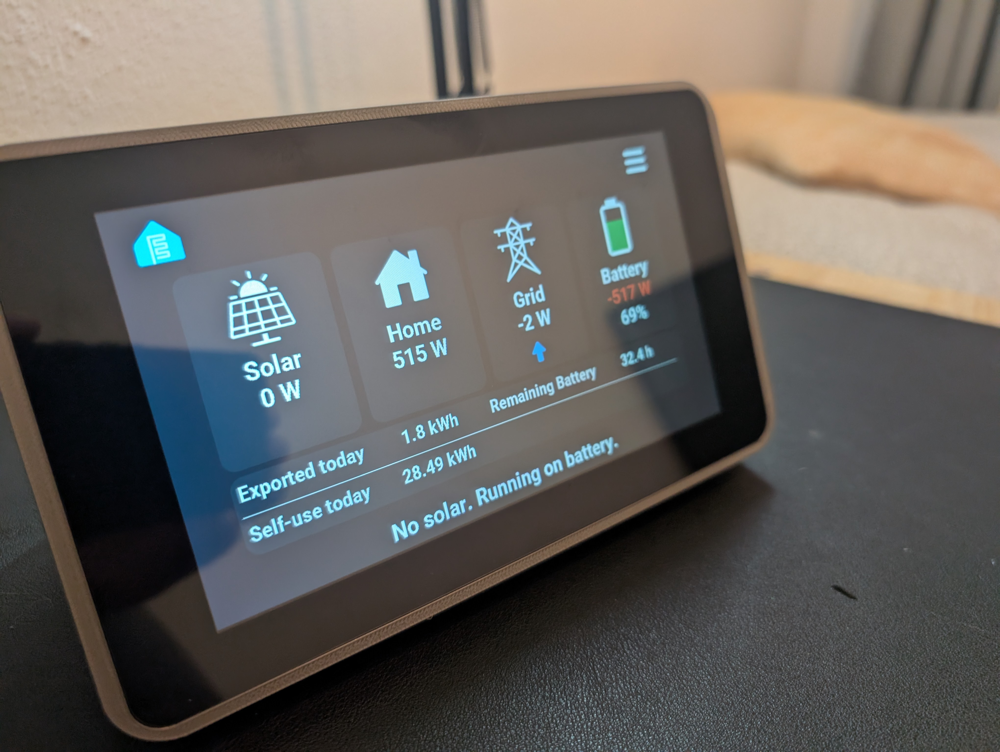

# Solar Display

A tabletop display that changes how you view and understand your **solar energy production** and **home energy consumption**.


---

## Project Overview

This is my **first GitHub project** and the first time I’m publicly sharing one of my projects. After putting so much time into it, it felt pointless to keep it to myself if no one else could enjoy or use it.

I originally just wanted a **pretty power flow display**. That idea quickly snowballed into:

> “But could I also add this graph… or that value?”

There **will be issues**, so please let me know if you find any. I’ll try to resolve them or help where I can.

---

## How it works

```
Inverter ──► Home Assistant integration ──► Home Assistant package ──► Solar Display
             (Sigenergy ESS or              (energy.yaml +             (one firmware,
              SolarEdge Modbus Multi)        energydevices.yaml)        Firmware/solar-display.yaml)
```

- **There is one display firmware for every inverter:** `Firmware/solar-display.yaml`. You never pick a firmware for your inverter brand.
- **Only the files in Home Assistant differ.** Each inverter has its own package (`Homeassistant/<inverter>/packages/`). The package turns that inverter's entities into a fixed set of shared sensors (`sensor.solar_panel_production_w`, `sensor.solar_battery_soc`, …), the same names for every brand.
- The display connects to Home Assistant with the ESPHome API and reads **only those shared sensors** (the full list: [`Homeassistant/migration/display-entities.txt`](Homeassistant/migration/display-entities.txt)). Supporting another inverter means writing a package that provides those names; the firmware stays the same.
- Everything you can change on the display is also on its device page in Home Assistant (see [Settings in Home Assistant](#settings-in-home-assistant)).

### What is in this repository

| Path | What it is |
|---|---|
| `Firmware/solar-display.yaml` | The display firmware (ESPHome), the same for every inverter |
| `Firmware/secrets.example.yaml` | Template for your `secrets.yaml` (Wi-Fi, keys); your own copy is never committed |
| `Firmware/includes/`, `fonts/`, `icons/` | C++ helpers, fonts and images the firmware uses |
| `Homeassistant/sigenergy/packages/` | Home Assistant package for **Sigenergy** |
| `Homeassistant/solaredge/single inverter/packages/` | Home Assistant package for **SolarEdge**, one inverter |
| `Homeassistant/solaredge/2 inverters/packages/` | Home Assistant package for **SolarEdge**, two inverters |
| `Homeassistant/migration/` | The list of entities the display reads, and the upgrade guide for older Sigenergy packages |
| `3Dfiles/` | The case (`.3mf`) |
| `HANDOVER.md` | Technical notes: everything that was changed and why, gotchas, test status |

---

## Inverter Compatibility

### Sigenergy
- Package: `Homeassistant/sigenergy/packages/`
- Made for systems **with a battery**
- Home Assistant integration (HACS): **Sigenergy ESS**

### SolarEdge
- Packages: `Homeassistant/solaredge/single inverter/packages/` or `Homeassistant/solaredge/2 inverters/packages/`
- Home Assistant integration (HACS): **SolarEdge Modbus Multi**

---

## Installation

### 1. Home Assistant

1. Install the integration for your inverter (see above).
2. Copy the two package files for your inverter into Home Assistant's packages folder:

   ```
   config/packages/
   ```

   - **`energy.yaml`**: energy meters, the shared sensors the display reads, helpers and other required entities.
   - **`energydevices.yaml`**: your own devices for the *Home Usage* page. That page can show power flowing from the house to a subpanel and on to individual devices. Add the power entities of your devices here; afterwards you pick them in the display's device settings and choose their icon and name.
3. Restart Home Assistant.

#### Sigenergy notes

Once the integration is installed, make sure the entity naming is the **standard Sigenergy naming**:

```
sensor.sigen_inverter_...
```

The package needs this naming.

#### SolarEdge notes

Because I have **two inverters**, I used the *SolarEdge Modbus Multi* integration (it also works with a single inverter). The package also does many of the extra calculations.

Keep the integration's standard naming (**do not change**):

- **B1** – Battery
- **I1 / I2** – Inverters
- **M1** – Meter

The single-inverter package only uses I1. Lifetime production is calculated from the inverters' own *AC Energy* counters, so the SolarEdge cloud integration is not needed.

### 2. Build and flash the display

Use a **decent computer**: the build is heavy, and building on a Raspberry Pi is extremely slow and not recommended. I use the ESPHome command-line tool (my Pi 5 with 16 GB could not handle this build).

Install the latest ESPHome ([Installing ESPHome Manually](https://esphome.io/guides/installing_esphome/)). On Windows:

```
python -m pip install --upgrade pip wheel esphome
```

Then:

1. Open the **Firmware** folder (the same firmware for every inverter).
2. Copy `secrets.example.yaml` to `secrets.yaml` and fill it in (Wi-Fi networks, keys).  
   **Generate your own `api_encryption_key`**, on the [ESPHome API docs page](https://esphome.io/components/api/) or with `openssl rand -base64 32`.  
   `secrets.yaml` is ignored by git, so your keys and Wi-Fi passwords stay on your PC.
3. Check the `substitutions:` at the top of `solar-display.yaml` (device name, `presence_sensor_default`, …).
4. Plug the display into your computer over USB and run:

   ```
   esphome run solar-display.yaml
   ```

### 3. Add it to Home Assistant

Once booted, the display connects to Wi-Fi and shows its IP address in its settings. Home Assistant usually discovers it by itself (ESPHome integration); otherwise add it with that IP and your `api_encryption_key`.

If Wi-Fi does not connect, you *can* enter a network in the display's settings, but reflashing with the correct credentials is recommended.

Enjoy!

### Updating over Wi-Fi (OTA)

After the first flash over USB, you never need to open the case again:

```
esphome run solar-display.yaml --device <display-ip>
```

- `api_encryption_key` and `ota_password` in `secrets.yaml` must match what is on the display, otherwise the upload is refused or Home Assistant cannot connect afterwards.
- If an update crashes on boot, ESPHome falls back to a safe mode after 10 failed boots, so you can upload again over Wi-Fi.
- Wi-Fi settings entered on the display itself are kept after an update.

### ESPHome Builder (Home Assistant add-on)

If your Home Assistant runs on a powerful PC, you can also build straight from this repository with the ESPHome Builder (not advised on a Raspberry Pi). Create a small config per display, e.g. `solar-display.yaml`, next to your `secrets.yaml` (with the same keys as above):

```yaml
substitutions:
  device_name: solar-display        # must match the display's current name
  friendly_name: Solar Display
  default_site: "0"                 # "1" for a display that belongs to site 2
  presence_sensor_default: "ON"     # "OFF" for a display without the presence sensor

packages:
  solar_display:
    url: https://github.com/ckegels/Solar-Monitor
    ref: main
    files: [Firmware/solar-display.yaml]
```

Fonts, icons and the C++ helpers are taken from the repository. If you use more than one Builder, give them all the same `secrets.yaml`; a different key or OTA password there would change it on the display at the next install.

---

## Using the display

### Swiping between pages

Swipe in from the edge of the screen to move between the main pages, in the same order as the menu: **Home → Power Flow → Solar → Battery → Grid → Graph → Home Usage** (and around again).

- Start at the **right** edge and swipe left for the next page.
- Start at the **left** edge and swipe right for the previous page.

Start the swipe within about 1 cm of the edge and move at least about 2 cm inwards. A tap near the edge still presses whatever button is there. Swiping does nothing on the menu and settings pages, or while the screen is off (the first touch only wakes it).

### Getting back home

Tap the **ESPHome logo** top left on any page to go back to the home page (the one chosen under *Original Home Page*); this also stops page rotation. On the home page itself the logo opens the menu. **Home** in the menu does the same.

### Themes

The display has 8 colour themes (Graphite is the default look). Pick one under **Settings → Themes**, or use the **Theme** select entity in Home Assistant, for example in an automation that switches to *OLED* at night. The choice is saved on the display and survives a power cut.

### Screen sleep

The **Screen Sleep** card on the Display page cycles through three modes:

- **Motion**: the screen stays on while the presence sensor (HMMD on GPIO6) sees someone, and wakes when someone walks past.
- **Touch**: for a display without the presence sensor. The sensor input is ignored; the screen sleeps a set time after the last touch.
- **Always**: the screen never sleeps.

The timeout (**Screen Timeout**) counts from the last presence or touch. A touch on a dark screen only wakes it; it does not press the button under your finger. In Home Assistant: *Display Auto Sleep* (off = Always), *Presence Sensor* (off = Touch) and *Display Timeout (s)*; turning the *Screen* switch on also wakes the screen. Set `presence_sensor_default: "OFF"` for a display without the sensor, so it starts in Touch mode.

### Two Home Assistant sites (optional)

One display can be used with two Home Assistant installations, for example your own and a family member's. It is off by default: turn it on in **Settings → Two Home Assistant sites** (or with the *Two Home Assistant Sites* switch). Then switch sites with:

- the **site button** next to the logo on the home page: it shows the current site, a tap switches to the other one;
- the two buttons at the top of the **boot screen**, or at the top of **Settings → Home Assistant**;
- the *Home Assistant Site* select in Home Assistant.

The display then restarts. Rename the sites with the ✎ button in Settings (on-screen keyboard), or with the *Site 1 Name* / *Site 2 Name* entities in Home Assistant. A new name appears in the select after the display's next restart.

- **Every display uses the same two sites:** site 1 = `api_encryption_key` on the normal API port **6053**, site 2 = `api_encryption_key_site_2` on port **6055**. So `secrets.yaml` is the same for all your displays. `site_1_name` / `site_2_name` are only the initial names. With `api_key_site_2: ""` (the default) site 2 uses the site 1 key; only the port differs.
- Per display, set `default_site` (`"0"` = site 1, `"1"` = site 2): the site a newly flashed display starts on.
- The **Home Usage** settings (device and subpanel names, icons, routing) are kept per site: after a switch the display shows the names of that site's devices. The *Home Usage …* entities follow the active site, so each Home Assistant sees and edits its own. With one site none of this is visible.
- After a switch the boot screen says so and shows what it is waiting for: Home Assistant can take up to a minute to reconnect.
- Add the display in **each** Home Assistant (ESPHome integration) with **that site's** port and key. For site 2, use Reconfigure (or add it) with port `6055` and the site 2 key.
- Only the selected site's port is open. The other Home Assistant just sees "connection refused", shows the display as unavailable and keeps retrying, so it reconnects by itself when you switch back. Separate keys alone are not enough: on a wrong key Home Assistant stops retrying and asks for re-authentication.
- After switching from Home Assistant, that Home Assistant can no longer reach the display; switch back on the display or from the other site's Home Assistant.

### Settings in Home Assistant

Everything you can set on the display, apart from Wi-Fi, can also be set on the display's device page in Home Assistant, and a change on either side shows up on the other:

| Section | Entities |
|---|---|
| Controls | *Screen* (on/off, wakes it), *Screen Brightness*, *Page Rotation* (start/stop), *Presence* |
| Configuration | *Theme*, *Display Auto Sleep*, *Presence Sensor*, *Display Timeout (s)*, *Show Tips*, *Show Graph Values*, *Show Daily Totals*, *Original Home Page*, *Simulate Backup Mode*, *Page Rotation Interval (s)*, *Rotate …* (one per page), *Home Usage Device 1–5 Name / Icon / Panel*, *Home Usage Subpanel 1–2* (shown or not) *Name / Icon*, *Two Home Assistant Sites*, *Restart Device*. Hidden until you enable them: *Home Assistant Site*, *Site 1/2 Name* |
| Diagnostic | *Uptime*, *Reset Reason*, *Free Internal RAM*, *Largest Free RAM Block*, *Lowest Free Internal RAM*, *WiFi Signal*, *WiFi IP*, *WiFi SSID*, *HMMD Presence* (the raw sensor pin) |

Configuration and Diagnostic entities are not on Home Assistant's automatic dashboards; open the device page to see them. *Uptime*, *Reset Reason* and the RAM sensors show whether a display restarted unexpectedly or ran low on memory.

---

## Upgrading from an older version

### From the old 2025.10.0 firmware

Take the new `Firmware/solar-display.yaml`, keep your own `secrets.yaml`, and update over Wi-Fi (see [Updating over Wi-Fi](#updating-over-wi-fi-ota)).

**Update the Home Assistant package first.** The firmware now reads the same sensor names for every inverter:
- **SolarEdge:** take the current package. It only adds `binary_sensor.solar_grid_connected` and `sensor.solar_battery_soc`.
- **Sigenergy:** the package's `package_sigen_…` sensors were renamed to the shared `solar_…` names. Follow [`Homeassistant/migration/HANDOVER-sigenergy-ha.md`](Homeassistant/migration/HANDOVER-sigenergy-ha.md). It renames the entities in Home Assistant so their history is kept, and updates your dashboards. Then flash the display.

Renamed entities (Home Assistant creates new entity ids, update automations that used them): *homepage toggle* → *Original Home Page*, *Show Tips/Suggestions* → *Show Tips*. Both start from their default once after the update. *Screen Backlight* and *LD1125H Distance* are gone; use *Screen* and *Screen Brightness*.

### If you changed the old YAML yourself

These are the changes needed for current ESPHome:

- Remove the `external_components:` block that points to `github://pr#10071` (`waveshare_io_ch32v003` is built in now)
- Remove `platformio_options:` under `esphome:` (ignored by the new build system)
- Remove `CONFIG_ESPTOOLPY_FLASHSIZE_8MB: y` from `sdkconfig_options` (conflicts with `flash_size: 16MB` and breaks the build)
- Add these `sdkconfig_options` (without them the screen glitches around text and elements):
  ```yaml
  CONFIG_ESP32S3_DATA_CACHE_LINE_64B: y
  CONFIG_ESP32S3_INSTRUCTION_CACHE_32KB: y
  CONFIG_LCD_RGB_ISR_IRAM_SAFE: y
  CONFIG_LCD_RGB_RESTART_IN_VSYNC: y
  CONFIG_FREERTOS_PLACE_FUNCTIONS_INTO_FLASH: n
  CONFIG_HEAP_PLACE_FUNCTION_INTO_FLASH: n
  ```
- ESPHome now uses LVGL 9 instead of LVGL 8. In lambdas:
  - `get_lv_img_dsc()` → `get_lv_image_dsc()`
  - `lv_point_t` → `lv_point_precise_t` (for `lv_line_set_points`)
- LVGL 9 has slightly different default padding; containers whose children fill them can suddenly show a scrollbar. Add `scrollable: false` and `scrollbar_mode: 'off'` to those containers.
- `image:` entries now need `- platform: file` in front of each image (the old format is removed in ESPHome 2027.1)
- `zoom:` on images is now `scale:`
- The display driver `rpi_dpi_rgb` is deprecated; use `platform: mipi_rgb` with `model: RPI` (same pins and timings) and `setup_priority: 800`
- Remove `reset_pin` from the `gt911` touchscreen. ESPHome's touch reset is too fast for this board and makes touch randomly fail to start (`touchscreen is marked FAILED: Calibration error`)
- Optional, for smooth scrolling: the performance changes (little-endian `data_pins`, a 16-line draw buffer in internal RAM from `includes/lvgl_helpers.h`, larger LVGL caches) are explained in [HANDOVER.md](HANDOVER.md)

---

## Hardware

- **3D Printed Case** (`3Dfiles/Solar-Case.3mf`)

- **Display:**  
  Waveshare S3 7-inch Display Development Board (Type B)  
  ESP32 with Display  
  Resolution: 1024×600  
  Optional touch function  
  32-bit LX7 dual-core processor (up to 240 MHz)  
  WiFi & Bluetooth support  
  [Waveshare Display Link](https://www.waveshare.com/esp32-s3-lcd-7b.htm?sku=31726)

- **8× M3 heat-set inserts**
- **12× M3 small screws**

- **MMWave Sensor**  
  Uses 3.3V, GND, and OT2 on the display GPIO.  
  The display works without this sensor: build with `presence_sensor_default: "OFF"`, or set Screen Sleep to **Touch** on the Display page.  
  [Example Link](https://de.aliexpress.com/item/1005007103251173.html?gatewayAdapt=glo2deu)

- **USB-C Power Plug**  
  Buy the **6-pin version** so it works regardless of USB-C cable orientation.  
  The display is very sensitive to power issues.  
  [Example Link](https://de.aliexpress.com/item/1005007524400372.html?gatewayAdapt=glo2deu)

- **Fabric Covering**  
  Fabric is glued and stretched around the case to give it a finished look.  
  The fabric used here was from an old polo shirt.  
  Glue used: *Tesa permanent spray glue*.

  I recommend using a stretchable fabric — this step was very difficult.

### Case Notes

The case can be 3D printed, but the design is **not ideal**. This was one of the first models I ever made.

To screw the display into the case, you’ll need a **bendable screwdriver attachment** (such as one from an iFixit kit), as access is very tight.

If anyone wants to redesign the case, please PM me for the CAD files.

---

## More Images




---

## Future Updates

I want to keep updating this project.

Currently, some text displayed on the homepage describes what the house is doing (for example: *battery low, please reduce usage*).  
These values are currently **hard-coded**, and I want to expose more numbers so setup is easier.

I would also like to:
- Allow changing the suggestion messages
- Add specific graphs to the interval page

Any suggestions would be really appreciated.
