# Solar Display

A tabletop display that changes how you view and understand your **solar energy production** and **home energy consumption**.

---

## Project Overview

This is my **first GitHub project** and the first time I’m publicly sharing one of my projects. After putting so much time into it, it felt pointless to keep it to myself if no one else could enjoy or use it.

I originally just wanted a **pretty power flow display**. That idea quickly snowballed into:

> “But could I also add this graph… or that value?”

There **will be issues**, so please let me know if you find any. I’ll try to resolve them or help where I can.

---

## Images

Example images of the Solar Display can be found in the `ReadmeImages` folder:

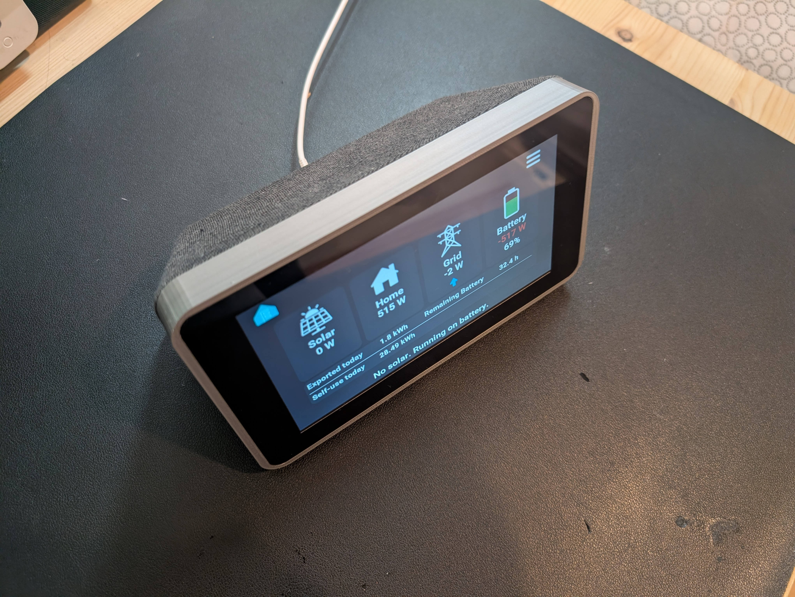

---

## Inverter Compatibility

There is **one display firmware** (`Firmware/`) for all supported inverters. What differs is the Home Assistant package: each inverter has its own package, and every package creates the same sensor names, which the display reads.

### Sigenergy
- Package for the **Sigenergy inverter**
- This version is made for systems **with a battery**
- Home Assistant Integration (HACS):
  - **Sigenergy ESS**

### SolarEdge
- Package for **SolarEdge**
- Home Assistant Integration (HACS):
  - **SolarEdge Modbus Multi**

---

## Software

### Home Assistant

Home Assistant is the **backbone** of this project.

#### Files needed in Home Assistant

Place these files in the packages folder:

```
config/packages/
```

- **`energy.yaml`**  
  Used for creating energy meters, usable sensors, helpers, and other required entities.

- **`energydevices.yaml`**  
  Used to add Home Assistant entities as devices.

  On the *Home Usage* page, there is an option to display power flow within the house. This allows energy to flow from the home to the first subpanel and then to individual devices.

  Power entities are added here so they can be displayed in the power flow view. Once devices are added, they can be selected in the device usage settings. You can choose device icons and set the name shown on the display.

---

### Swiping between pages

Swipe in from the edge of the screen to move between the main pages, in the same order as the menu: **Home → Power Flow → Solar → Battery → Grid → Graph → Home Usage** (and around again).

- Start at the **right** edge and swipe left for the next page.
- Start at the **left** edge and swipe right for the previous page.

Start the swipe within about 1 cm of the edge and move at least about 2 cm inwards. A tap near the edge still presses whatever button is there. Swiping does nothing on the menu and settings pages, or while the screen is off (the first touch only wakes it).

---

### Themes

The display has 8 colour themes (Graphite is the default look). Pick one under **Settings → Themes**, or use the **Theme** select entity in Home Assistant, for example in an automation that switches to *OLED* at night. The choice is saved on the display and survives a power cut.

---

### Sigenergy Notes

Once the integration is installed, make sure the entity naming is the **standard Sigenergy naming**:

```
sensor.sigen_inverter_...
```

This naming is required for the energy file to work correctly.

---

### SolarEdge Notes

Because I have **two inverters**, I needed to use the *SolarEdge Modbus Multi* integration (it also works with a single inverter).

I also needed an energy file to handle many of the additional calculations.

Current naming convention (this is the standard provided by the integration — **do not change**):

- **B1** – Battery
- **I1 / I2** – Inverters
- **M1** – Meter

There are Home Assistant package files for both setups:

- `Homeassistant/solaredge/2 inverters/packages/`
- `Homeassistant/solaredge/single inverter/packages/` (only uses I1)

Lifetime production is calculated from the inverters' own *AC Energy* counters, so the SolarEdge cloud integration is not needed.

---

## ESPHome

- ✅ **Now works with the latest ESPHome!** The issues with the display are resolved, so you no longer need to stick to an old version.

### Upgrading from the old 2025.10.0 version

If you are running the old firmware, just take the new `Firmware/solar-display.yaml`, keep your own `secrets.yaml`, and update over Wi-Fi (see [Updating over Wi-Fi](#updating-over-wi-fi-ota)).

**Update the Home Assistant package first.** The firmware now reads the same sensor names for every inverter:
- **SolarEdge:** take the current package. It only adds `binary_sensor.solar_grid_connected` and `sensor.solar_battery_soc`.
- **Sigenergy:** the package's `package_sigen_…` sensors were renamed to the shared `solar_…` names. Follow [`Homeassistant/migration/HANDOVER-sigenergy-ha.md`](Homeassistant/migration/HANDOVER-sigenergy-ha.md). It renames the entities in Home Assistant so their history is kept, and updates your dashboards. Then flash the display.

If you made your own changes to the old YAML, these are the changes needed for current ESPHome:

- Remove the `external_components:` block that points to `github://pr#10071` (`waveshare_io_ch32v003` is built in now)
- Remove `platformio_options:` under `esphome:` (ignored by the new build system)
- Remove `CONFIG_ESPTOOLPY_FLASHSIZE_8MB: y` from `sdkconfig_options` (conflicts with `flash_size: 16MB` and breaks the build)
- Add these `sdkconfig_options` (without them the screen glitches around text and elements):
  ```yaml
  CONFIG_ESP32S3_DATA_CACHE_LINE_64B: y
  CONFIG_ESP32S3_INSTRUCTION_CACHE_32KB: y
  CONFIG_LCD_RGB_ISR_IRAM_SAFE: y
  CONFIG_LCD_RGB_RESTART_IN_VSYNC: y
  CONFIG_FREERTOS_PLACE_FUNCTIONS_INTO_FLASH: n
  CONFIG_HEAP_PLACE_FUNCTION_INTO_FLASH: n
  ```
- ESPHome now uses LVGL 9 instead of LVGL 8. In lambdas:
  - `get_lv_img_dsc()` → `get_lv_image_dsc()`
  - `lv_point_t` → `lv_point_precise_t` (for `lv_line_set_points`)
- LVGL 9 has slightly different default padding; containers whose children fill them can suddenly show a scrollbar. Add `scrollable: false` and `scrollbar_mode: 'off'` to those containers.
- `image:` entries now need `- platform: file` in front of each image (the old format is removed in ESPHome 2027.1)
- `zoom:` on images is now `scale:`
- The display driver `rpi_dpi_rgb` is deprecated; use `platform: mipi_rgb` with `model: RPI` (same pins and timings) and `setup_priority: 800`
- Remove `reset_pin` from the `gt911` touchscreen. ESPHome's touch reset is too fast for this board and makes touch randomly fail to start (`touchscreen is marked FAILED: Calibration error`)
- Optional, for smooth scrolling: the performance changes (little-endian `data_pins`, a 20-line draw buffer in internal RAM from `includes/lvgl_helpers.h`, larger LVGL caches) are explained in [HANDOVER.md](HANDOVER.md)

### Build Recommendation

I recommend building this using the **command-line version of ESPHome** on a powerful computer.  
Building on a Raspberry Pi is very demanding and **not recommended**.

---

## Hardware

- **3D Printed Case**

- **Display:**  
  Waveshare S3 7-inch Display Development Board (Type B)  
  ESP32 with Display  
  Resolution: 1024×600  
  Optional touch function  
  32-bit LX7 dual-core processor (up to 240 MHz)  
  WiFi & Bluetooth support  
  [Waveshare Display Link](https://www.waveshare.com/esp32-s3-lcd-7b.htm?sku=31726)

- **8× M3 heat-set inserts**
- **12× M3 small screws**

- **MMWave Sensor**  
  Uses 3.3V, GND, and OT2 on the display GPIO.  
  (The display works without this sensor. If not used, disable the motion sensor option in settings.)  
  [Example Link](https://de.aliexpress.com/item/1005007103251173.html?gatewayAdapt=glo2deu)

- **USB-C Power Plug**  
  Buy the **6-pin version** so it works regardless of USB-C cable orientation.  
  The display is very sensitive to power issues.  
  [Example Link](https://de.aliexpress.com/item/1005007524400372.html?gatewayAdapt=glo2deu)

- **Fabric Covering**  
  Fabric is glued and stretched around the case to give it a finished look.  
  The fabric used here was from an old polo shirt.  
  Glue used: *Tesa permanent spray glue*.

  I recommend using a stretchable fabric — this step was very difficult.

---

## Case Notes

The case can be 3D printed, but the design is **not ideal**. This was one of the first models I ever made.

To screw the display into the case, you’ll need a **bendable screwdriver attachment** (such as one from an iFixit kit), as access is very tight.

If anyone wants to redesign the case, please PM me for the CAD files.

---

## Installation

### Home Assistant

1. Pick which inverter you are using (**Sigenergy** or **SolarEdge**)
2. Place the package files into:

```
config/packages/
```

---

### ESPHome Builder

Before flashing the device, you’ll need a **decent computer**. Flashing from a Raspberry Pi is extremely slow and not recommended.

I used the ESPHome **command-line tool on Windows**, as my Pi 5 (16GB) could not handle this build.

Download and install the latest ESPHome:  
[Installing ESPHome Manually](https://esphome.io/guides/installing_esphome/)

For Windows, the command should be:

```
python -m pip install --upgrade pip wheel esphome
```

If you have a powerful PC running Home Assistant, you *can* also build it with the regular ESPHome add-on  
(not advised for Raspberry Pi).

---

### Flashing the Display

1. Open the **Firmware** folder (the same firmware for every inverter)
2. Open PowerShell in that folder
3. Open `solar-display.yaml`
4. Copy `secrets.example.yaml` to `secrets.yaml` and fill it in, then fill in the substitutions  
   **Generate your own `api_encryption_key`.** You can generate one on the [ESPHome API docs page](https://esphome.io/components/api/) or with `openssl rand -base64 32`.  
   `secrets.yaml` is ignored by git, so your keys and Wi-Fi passwords stay on your PC.
5. Plug the display into your computer

Run:

```
esphome run solar-display.yaml
```

### Two Home Assistant sites (optional)

One display can be used with two Home Assistant installations, for example your own and a family member's. It is off by default: turn it on in **Settings → Two Home Assistant sites** (or with the *Two Home Assistant Sites* switch). Then choose the site with the two buttons at the top of the **boot screen**, or at the top of **Settings → Home Assistant**; the display then restarts. You can also switch from Home Assistant with the *Home Assistant Site* select. Rename the sites with the ✎ button there (on-screen keyboard), or with the *Site 1 Name* / *Site 2 Name* entities in Home Assistant. A new name appears in the select after the display's next restart.

- **Every display uses the same two sites:** site 1 = `api_encryption_key` on the normal API port **6053**, site 2 = `api_encryption_key_site_2` on port **6055**. So `secrets.yaml` is the same for all your displays. `site_1_name` / `site_2_name` are only the initial names. With `api_key_site_2: ""` (the default) site 2 uses the site 1 key; only the port differs.
- Per display, set `default_site` (`"0"` = site 1, `"1"` = site 2): the site a newly flashed display starts on.
- The **Home Usage** settings (device and subpanel names, icons, routing) are kept per site: after a switch the display shows the names of that site's devices. The *Home Usage …* entities follow the active site, so each Home Assistant sees and edits its own. With one site none of this is visible.
- After a switch the boot screen says so and shows what it is waiting for: Home Assistant can take up to a minute to reconnect.
- Add the display in **each** Home Assistant (ESPHome integration) with **that site's** port and key. For site 2, use Reconfigure (or add it) with port `6055` and the site 2 key.
- Only the selected site's port is open. The other Home Assistant just sees "connection refused", shows the display as unavailable and keeps retrying, so it reconnects by itself when you switch back. Separate keys alone are not enough: on a wrong key Home Assistant stops retrying and asks for re-authentication.
- After switching from Home Assistant, that Home Assistant can no longer reach the display; switch back on the display or from the other site's Home Assistant.

### Screen sleep

The **Screen Sleep** card on the Display page cycles through three modes:

- **Motion**: the screen stays on while the presence sensor (HMMD on GPIO6) sees someone, and wakes when someone walks past.
- **Touch**: for a display without the presence sensor. The sensor input is ignored; the screen sleeps a set time after the last touch.
- **Always**: the screen never sleeps.

The timeout (**Screen Timeout**) counts from the last presence or touch. A touch on a dark screen only wakes it; it does not press the button under your finger. In Home Assistant: *Display Auto Sleep* (off = Always), *Presence Sensor* (off = Touch) and *Display Timeout (s)*; turning the *Screen* switch on also wakes the screen. Set `presence_sensor_default: "OFF"` for a display without the sensor, so it starts in Touch mode.

### Settings in Home Assistant

Everything you can set on the display, apart from Wi-Fi, can also be set on the display's device page in Home Assistant, and a change on either side shows up on the other:

| Section | Entities |
|---|---|
| Controls | *Screen* (on/off, wakes it), *Screen Brightness*, *Page Rotation* (start/stop), *Presence* |
| Configuration | *Theme*, *Display Auto Sleep*, *Presence Sensor*, *Display Timeout (s)*, *Show Tips*, *Show Graph Values*, *Show Daily Totals*, *Original Home Page*, *Simulate Backup Mode*, *Page Rotation Interval (s)*, *Rotate …* (one per page), *Home Usage Device 1–5 Name / Icon / Panel*, *Home Usage Subpanel 1–2* (shown or not) *Name / Icon*, *Two Home Assistant Sites*, *Restart Device*. Hidden until you enable them: *Home Assistant Site*, *Site 1/2 Name* |
| Diagnostic | *Uptime*, *Reset Reason*, *Free Internal RAM*, *Largest Free RAM Block*, *Lowest Free Internal RAM*, *WiFi Signal*, *WiFi IP*, *WiFi SSID*, *HMMD Presence* (the raw sensor pin) |

*Uptime*, *Reset Reason* and the RAM sensors show whether a display restarted unexpectedly or ran low on memory.

Renamed in this version (Home Assistant creates new entity ids, update automations that used them): *homepage toggle* → *Original Home Page*, *Show Tips/Suggestions* → *Show Tips*. Both start from their default once after the update. *Screen Backlight* and *LD1125H Distance* are gone; use *Screen* and *Screen Brightness*.

### ESPHome Builder (Home Assistant add-on)

You can build straight from this repository. Create a small config per display, e.g. `solar-display.yaml`, next to your `secrets.yaml` (with the same keys as above):

```yaml
substitutions:
  device_name: solar-display        # must match the display's current name
  friendly_name: Solar Display
  default_site: "0"                 # "1" for a display that belongs to site 2
  presence_sensor_default: "ON"     # "OFF" for a display without the presence sensor

packages:
  solar_display:
    url: https://github.com/ckegels/Solar-Monitor
    ref: main
    files: [Firmware/solar-display.yaml]
```

Fonts, icons and the C++ helpers are taken from the repository. If you use more than one Builder, give them all the same `secrets.yaml`; a different key or OTA password there would change it on the display at the next install.

### Updating over Wi-Fi (OTA)

After the first flash over USB, you never need to open the case again. Updates can be sent over Wi-Fi:

```
esphome run solar-display.yaml --device <display-ip>
```

- `api_encryption_key` and `ota_password` in `secrets.yaml` must match what is on the display, otherwise the upload is refused or Home Assistant cannot connect afterwards.
- If an update crashes on boot, ESPHome falls back to a safe mode after 10 failed boots, so you can upload again over Wi-Fi.
- Wi-Fi settings entered on the display itself are kept after an update.

---

## First Boot

Once booted, the device should automatically connect to Wi-Fi.

You can find the device IP address in the settings and add it to Home Assistant.

If Wi-Fi fails to connect, you *can* enter credentials in settings, but reflashing with the correct credentials is recommended.

Enjoy!

---

## More Images

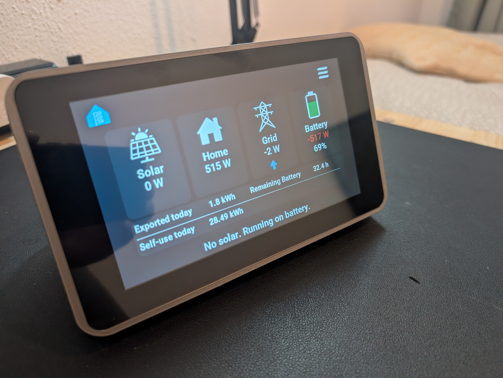

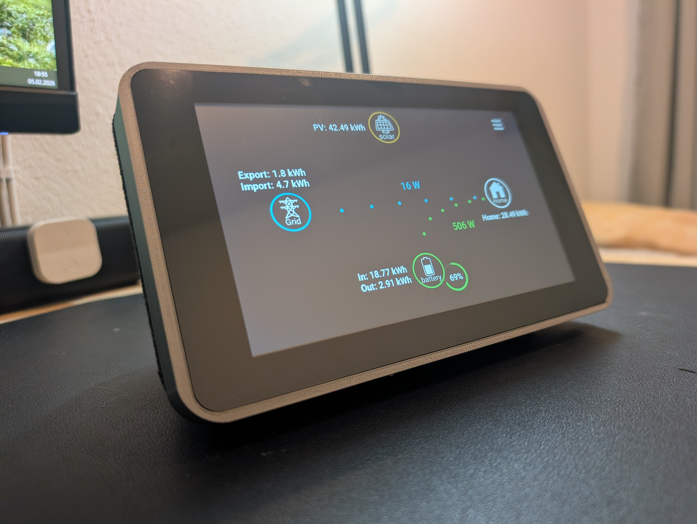
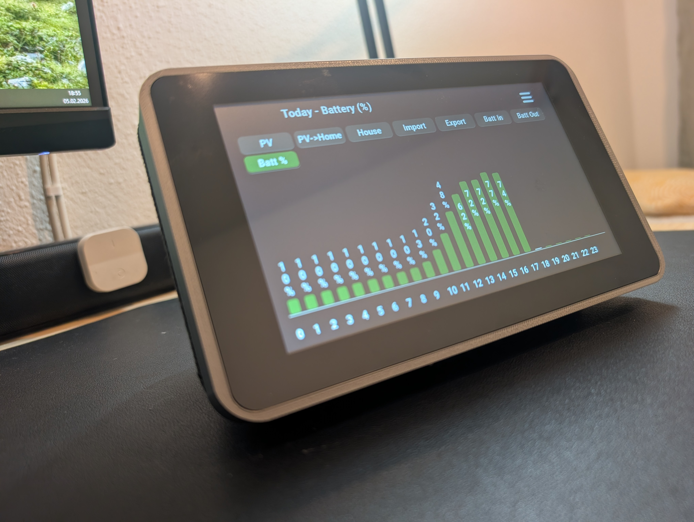
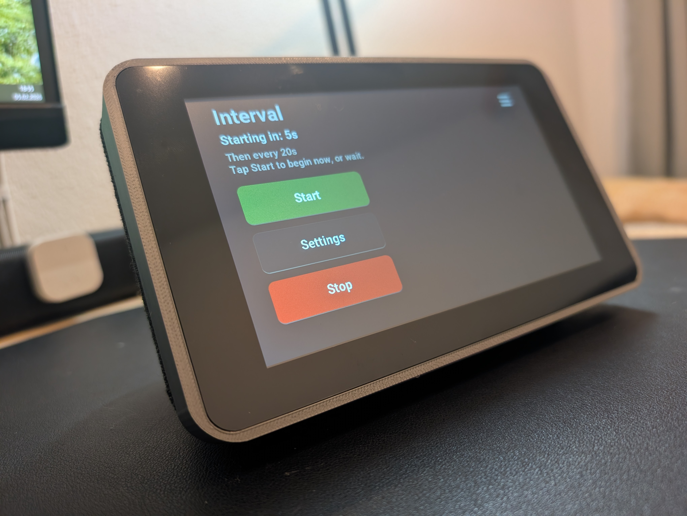
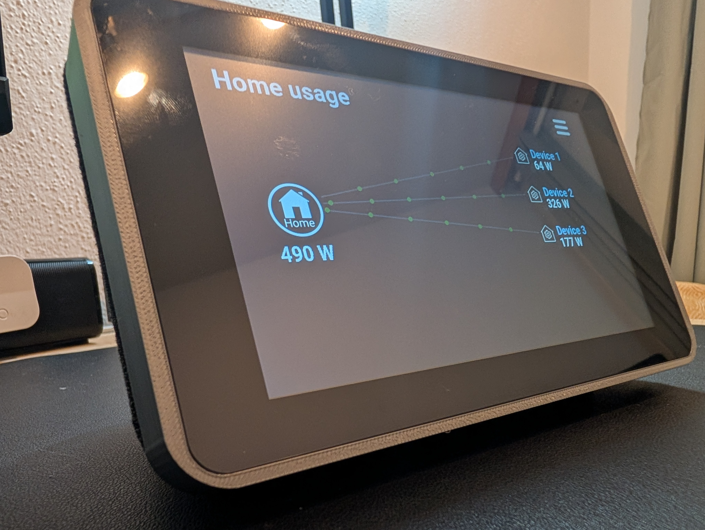
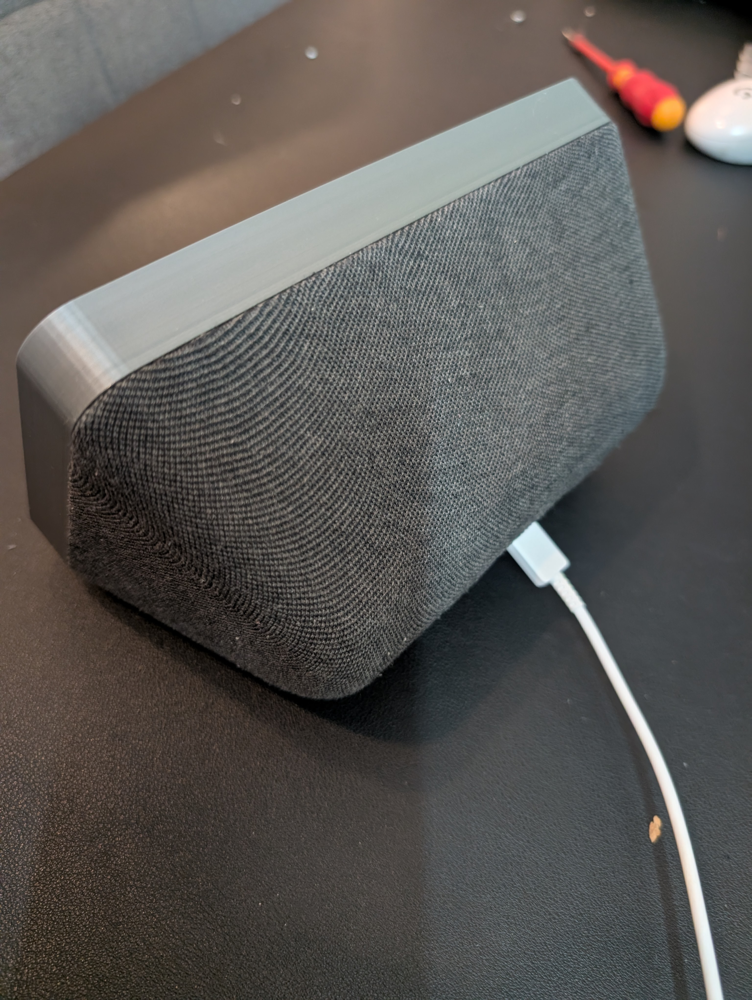
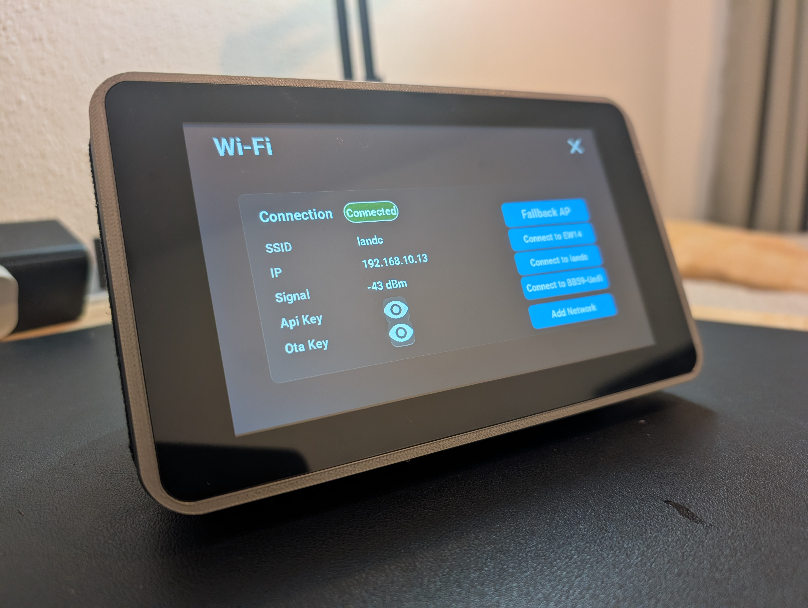
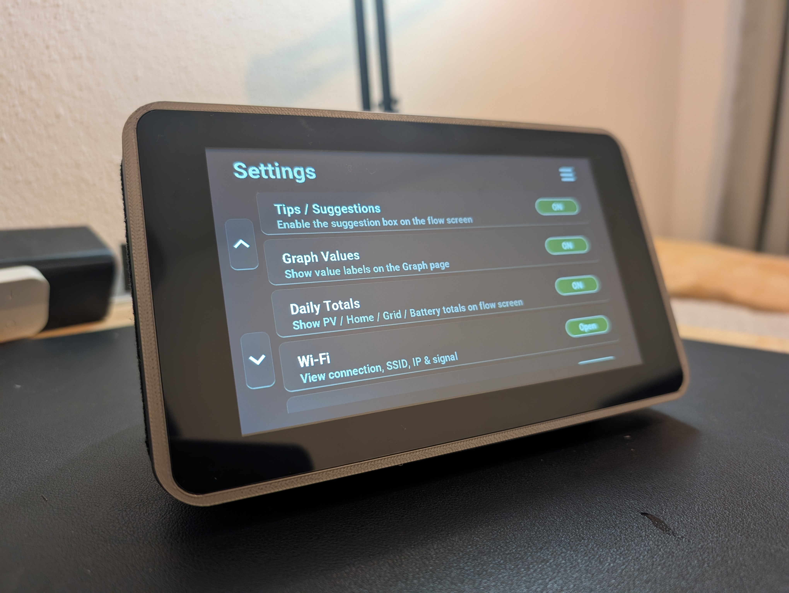
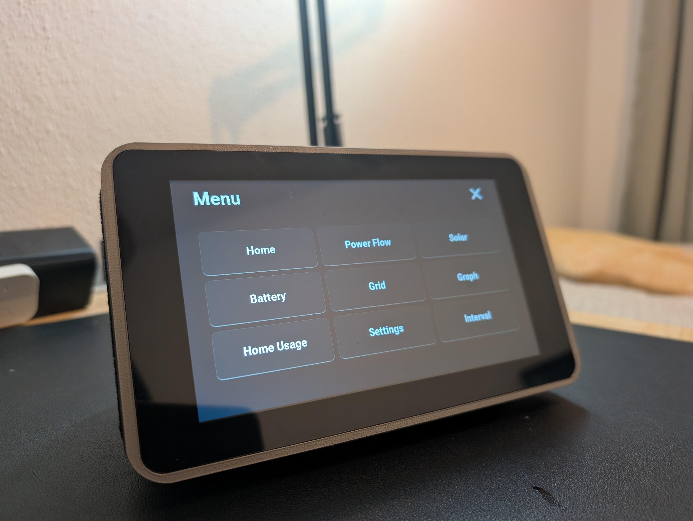
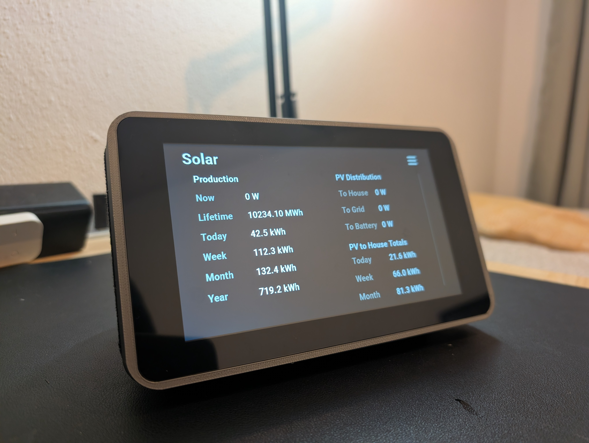

---

## Future Updates

I want to keep updating this project.

Currently, some text displayed on the homepage describes what the house is doing (for example: *battery low, please reduce usage*).  
These values are currently **hard-coded**, and I want to expose more numbers so setup is easier.

I would also like to:
- Allow changing the suggestion messages
- Add specific graphs to the interval page

Any suggestions would be really appreciated.
